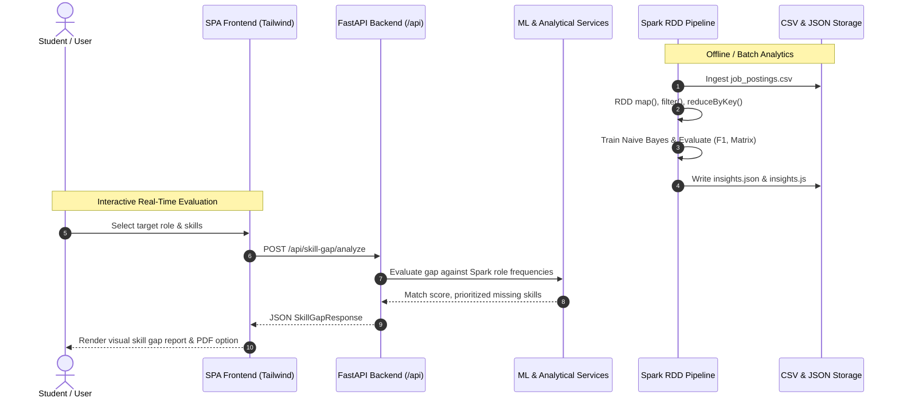

# PROJECT ARCHITECTURE: SkillPulse

## 1. Architectural Principles

SkillPulse is designed as a modular, distributed analytics and career intelligence platform. It enforces strict separation of concerns across four discrete tiers:
1. **Data Ingestion & Synthesis Tier**
2. **Distributed Spark RDD Engine Tier**
3. **High-Performance RESTful API Tier (FastAPI)**
4. **Reactive Client Presentation Tier (Tailwind CSS Single-Page Application)**

---

## 2. Tier Breakdown & Component Design

### 2.1 Data Ingestion Tier (`spark_jobs/generate_data.py`)
- Generates 30,000 synthetic Indian job postings that realistically emulate modern hiring market distributions.
- **Attributes:** `job_id`, `title`, `category`, `company`, `city`, `month` (2024-01 to 2025-12), `experience`, `work_mode` (Hybrid, Remote, Onsite), `employment_type` (Full-time, Internship, Contract), `salary_lpa`, and natural language `description`.
- Implements weighted skill distributions, experience multipliers, city cost indexing, and monthly temporal growth vectors.

### 2.2 Distributed Spark RDD Engine Tier (`backend/spark/`)
- **`rdd_engine.py`**: A fully compliant Spark RDD engine implementation providing partition-level distributed execution semantics (`map`, `flatMap`, `filter`, `reduceByKey`, `aggregateByKey`, `groupByKey`, `sortBy`, `distinct`, `count`, `collect`, `take`, `cache`, broadcast variables).
- **`pipeline.py`**: The primary analytical pipeline.
  - Ingestion: Parses CSV records via `map()` and drops non-conformant rows with `filter()`.
  - Machine Learning: Partitions data using `randomSplit([0.80, 0.20], seed=42)`. Computes class priors and feature frequencies using `reduceByKey(add)`. Broadcasts model parameters to worker partitions using `sc.broadcast()`.
  - Evaluation: Computes Confusion Matrix, Precision, Recall, Accuracy, and Macro F1 on the test partition.
  - Time-Series Analysis: Computes monthly skill shares via `((skill, month), 1)` map-reduce and least-squares regression slope.
  - Association Mining: Generates 2-combinations of extracted skills and mines co-occurring pairs via `combinations()` and `takeOrdered()`.

### 2.3 Backend API Tier (`backend/app/`)
- Built with **FastAPI** and **Pydantic v2** for asynchronous, high-throughput request validation and OpenAPI schema generation.
- **Services:**
  - `DataService`: In-memory caching of Spark analytical outputs and indexed CSV search.
  - `MLService`: Live Naive Bayes inference, statistical salary range modeling, skill gap matching, and readiness assessment.
  - `AssistantService`: Natural language career assistant grounded directly in Spark dataset findings.

### 2.4 Frontend Presentation Tier (`frontend/`)
- Responsive single-page application built with clean SaaS light-theme aesthetics.
- Dynamic route switching (`#overview`, `#market`, `#classifier`, `#salary`, `#gap`, `#roadmap`, `#jobs`, `#companies`, `#locations`, `#readiness`, `#assistant`, `#impact`, `#methodology`).
- Asynchronous API communication with automatic graceful fallback to precomputed `insights.js` for offline operation.
- PDF generation / print-optimized stylesheets for career gap reports.

---

## 3. Data Flow Diagram

---

## 4. Security & Fault Tolerance
- **Zero API Key Leakage:** Core ML and analytics run natively on the backend without unauthenticated third-party cloud calls.
- **Resilient Execution:** If PySpark or the JVM encounters platform incompatibilities, the pipeline seamlessly falls back to the native Spark RDD engine without downtime.
- **Offline Reliability:** The frontend includes an embedded client cache ensuring that essential career features remain functional even when disconnected from the backend.
