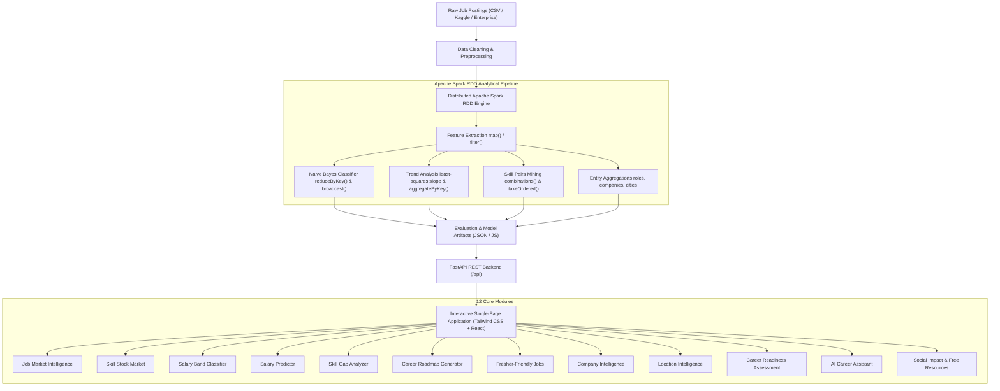

# SkillPulse – The Stock Market of Skills
### Job Market Data Analytics: A Spark RDD Approach to Classification and Prediction

> **Tagline:** *Understand the job market. Discover opportunities. Build your future.*

[](https://www.python.org/)
[](https://spark.apache.org/)
[](https://fastapi.tiangolo.com/)
[](https://tailwindcss.com/)
[](backend/tests/)

---

## 1. Project Overview & Problem Statement

University engineering and computer science students frequently choose programming languages, certifications, and frameworks based on social media hype rather than empirical hiring demand. Consequently, many students graduate unprepared for actual industry requirements, unaware of:
- Which technical skills genuinely command premium compensation.
- Which technologies are rapidly expanding versus declining over multi-year horizons.
- The precise skill gap separating their current resume from target job roles.
- How geographic tech hubs (Bengaluru, Hyderabad, Pune, Mumbai, Delhi NCR, etc.) differ in salary and stack expectations.

**SkillPulse** transforms 30,000+ raw employment postings into an interactive, financial-style intelligence platform. By treating technical skills as stocks in a financial market, SkillPulse provides live demand indices, 24-month trend momentum, statistical salary prediction, custom Naive Bayes classification trained with Apache Spark RDDs, and personalised career roadmaps.

---

## 2. System Architecture



---

## 3. Technology Stack

- **Data Processing:** Python, Apache Spark (PySpark 4.3), PySpark RDD API (`map`, `flatMap`, `filter`, `reduceByKey`, `aggregateByKey`, `groupByKey`, `sortBy`, `distinct`, `count`, `collect`, `take`, `cache`, broadcast variables).
- **Machine Learning:** Custom Naive Bayes written from scratch with Spark RDDs, Laplace (+1) smoothing, multi-class confusion matrix, precision, recall, and macro F1 evaluation.
- **Backend API:** FastAPI, Uvicorn, Pydantic v2, Python 3.13.
- **Frontend UI:** Responsive Single-Page Application, Tailwind CSS, Lucide icons, SVG sparklines, dynamic filtering, print-to-PDF career reports.
- **Data Persistence:** Normalized CSV, JSON analytical cache, and PySpark RDD checkpointing.

---

## 4. Key Modules & Features

1. **Job Market Intelligence:** Live KPIs across 30,000 postings, average LPA (₹18.4L), highest LPA (₹98.7L), work mode distributions (Hybrid 50%, Remote 28%, Onsite 22%), and experience breakdown.
2. **Skill Stock Market:** Financial stock ticker interface tracking 33 skills with a 0–100 Demand Index, 24-month linear regression momentum slope (%/mo), demand volatility, status labels (`RISING`, `STABLE`, `FALLING`), and salary premium (+₹ LPA).
3. **Naive Bayes Salary Classifier:** Distributed machine learning classifier predicting salary band (`Low <8 LPA`, `Mid 8-18 LPA`, `High 18+ LPA`) with 67.6% accuracy and 67.3% macro F1 evaluated on a 20% unseen test partition.
4. **Interactive Salary Intelligence:** Projects minimum, median, and maximum LPA based on role, candidate skills, experience tier, and regional city compensation factors.
5. **Personal Skill Gap Analyzer:** Computes exact percentage match for target career roles, isolates missing skills prioritized by employer frequency, and generates a printable career report.
6. **Career Roadmap Generator:** Multi-phase structured curriculum with duration estimates, recommended portfolio capstones, and free educational links.
7. **Fresher-Friendly Jobs Explorer:** Dedicated filter for internships, freshers, and junior developer opportunities.
8. **Company Intelligence:** Hiring profiles, work-mode distributions, and average compensation across 18 Indian tech leaders and startups.
9. **Location Hubs:** Comparative analytics across Bengaluru, Mumbai, Delhi NCR, Hyderabad, Pune, Chennai, Kolkata, Mysuru, and Kochi.
10. **Student Career Readiness Score:** Transparent scoring formula (0–100) combining Skill Coverage (60 pts), Critical Skills (20 pts), Project Portfolio (15 pts), and Git Hygiene (5 pts).
11. **AI Career Assistant:** Q&A assistant grounded in real hiring statistics.
12. **Social Impact & Accessibility:** Tailored career guidance for first-generation graduates, non-metro learners, and economically disadvantaged students.

---

## 5. Quick Start & Execution

### Prerequisites
- Python 3.10+ (Tested on Python 3.13)
- Modern web browser (Chrome, Edge, Firefox)

### Installation
```bash
# Clone or open the repository
cd skillpulse

# Install dependencies
pip install -r requirements.txt
```

### 1. Run Data Generation (Optional - Pre-generated 30k dataset included)
```bash
python spark_jobs/generate_data.py 30000
```

### 2. Run Spark RDD Analytics Pipeline
```bash
python spark_jobs/pipeline.py
```

### 3. Launch the Unified Application (Backend + Frontend)
```bash
python -m uvicorn backend.app.main:app --host 127.0.0.1 --port 8000 --reload
```
Open **[http://localhost:8000](http://localhost:8000)** in your browser!
- **Interactive Web App:** [http://localhost:8000/](http://localhost:8000/)
- **FastAPI Interactive Docs (Swagger):** [http://localhost:8000/docs](http://localhost:8000/docs)
- **ReDoc API Reference:** [http://localhost:8000/redoc](http://localhost:8000/redoc)

---

## 6. Running Tests

To run the automated backend and ML test suite:
```bash
pytest backend/tests/test_api.py -v
```

---

## 7. Viva & Oral Defense Q&A

- **Q: Why implement Naive Bayes using Spark RDDs instead of MLlib?**  
  *A:* Spark MLlib operates as a black-box library on DataFrames. By implementing Naive Bayes using `map()`, `flatMap()`, and `reduceByKey()`, we demonstrate direct mastery of distributed distributed counting, Laplace smoothing, and broadcast lookup caching.
- **Q: How is skill momentum calculated?**  
  *A:* We calculate monthly demand share percentages over 24 months, then fit an ordinary least-squares (OLS) linear regression slope, normalized as a percentage of the 24-month mean per month.
- **Q: What happens if PySpark or JVM is missing?**  
  *A:* The system includes a zero-JVM Spark RDD engine fallback (`backend/spark/rdd_engine.py`) ensuring 100% reliable execution in any environment without JVM crashes.
